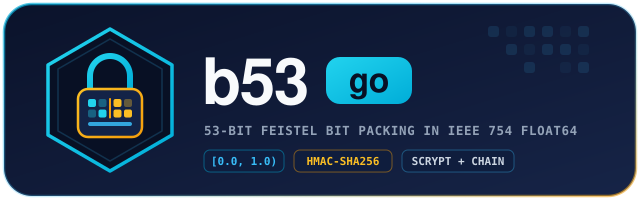

<p align="center">
  
</p>

# b53-go

**English** | [🇷🇺 Русская версия](README_RU.md)

[](https://pkg.go.dev/github.com/1orgar/b53-go)
[](https://opensource.org/licenses/MIT)
[](https://github.com/1orgar/b53-go/actions/workflows/ci.yml)

**`b53-go`** is a zero-dependency Go library and CLI for reversible cryptographic packing of boolean slices of arbitrary length into IEEE 754 `binary64` (`float64`) values in the half-open interval $[0.0, 1.0)$.

It is wire-compatible and cryptographically interoperable with the Python [`b53`](https://github.com/1orgar/b53) library across single-float encryption, chained arbitrary-length serialization, and `scrypt` password key stretching.

## Key Properties

- **Hidden length inside the float:** for `1..50` booleans, the original length $L \in [1, 50]$ is encoded directly inside the 53-bit mantissa space—no external length metadata is required.
- **Randomized output (nonce) per encryption:** encrypting the same boolean slice with the same salt produces different pseudorandom `float64` values in $[0.0, 1.0)$.
- **Bijective 53-bit permutation:** uses an 8-round unbalanced Feistel network ($26 + 27 = 53$ bits) keyed by `HMAC-SHA256` with your secret salt.
- **Chained arbitrary-length serialization:** `Serialize` / `Deserialize` split slices of any length into `(len / minSize) + 1` randomized chunks with chained per-chunk salts bound to chunk count, index, and previous chunk size.
- **Built-in `scrypt` KDF (RFC 7914):** `DeriveSalt` and `NewCipherFromPassword` stretch human passwords into 256-bit keys with optional domain-separation context.
- **Pure Go standard library:** zero external dependencies, goroutine-safe `Cipher`, Go 1.22+.

## Installation

Library:

```bash
go get github.com/1orgar/b53-go
```

CLI binary:

```bash
go install github.com/1orgar/b53-go/cmd/b53@latest
```

## Quick Start

### Go API

```go
package main

import (
	"fmt"
	"log"

	"github.com/1orgar/b53-go"
)

func main() {
	// 1. Generate a 256-bit secret salt (or derive one from a password via scrypt)
	salt, err := b53.GenerateSalt(b53.DefaultSaltBytes)
	if err != nil {
		log.Fatal(err)
	}
	// salt, err = b53.DeriveSalt("my-passphrase", b53.WithContext("user:42"))

	// 2. Encrypt a boolean slice (1..50 elements) into a float64 in [0.0, 1.0)
	bits := []bool{true, false, true, true, false, false, true, false, true, true}
	x1, err := b53.Encrypt(bits, salt)
	if err != nil {
		log.Fatal(err)
	}
	x2, err := b53.Encrypt(bits, salt) // different float64 due to random nonce
	if err != nil {
		log.Fatal(err)
	}
	fmt.Println("distinct:", x1 != x2)

	// 3. Decrypt back to the exact original []bool and length
	restored, err := b53.Decrypt(x1, salt)
	if err != nil {
		log.Fatal(err)
	}
	fmt.Println(b53.FormatBits(restored)) // 1011001011

	// 4. Serialize/deserialize an arbitrary-length boolean slice into []float64
	manyBits := make([]bool, 250)
	for i := range manyBits {
		manyBits[i] = i%3 == 0
	}
	doubles, err := b53.Serialize(manyBits, salt, b53.WithMinSize(10))
	if err != nil {
		log.Fatal(err)
	}
	recoveredMany, err := b53.Deserialize(doubles, salt)
	if err != nil {
		log.Fatal(err)
	}
	fmt.Println("chunks:", len(doubles), "matched:", b53.FormatBits(recoveredMany) == b53.FormatBits(manyBits))
}
```

For repeated operations with the same salt (safe for concurrent goroutines), use `Cipher`:

```go
cipher, err := b53.NewCipher(salt) // accepts hex string, UTF-8 passphrase, or []byte
// or: cipher, err := b53.NewCipherFromPassword("my-passphrase", b53.WithContext("tenant-a"))
if err != nil {
	log.Fatal(err)
}

encoded, err := cipher.EncryptString("1011001011")
if err != nil {
	log.Fatal(err)
}
fmt.Println(encoded)
fmt.Println(cipher.DecryptString(encoded)) // "1011001011"

doubles, err := cipher.Serialize(manyBits) // default minSize = 10
if err != nil {
	log.Fatal(err)
}
restoredMany, err := cipher.Deserialize(doubles)
```

### Command-Line Interface

```bash
# 1. Generate a 256-bit hex salt (or stretch a passphrase via scrypt)
SALT=$(b53 generate-salt)
# SALT=$(b53 derive-salt "my-passphrase" --context "user:42")

# 2. Encrypt the same bit string 3 times
b53 encrypt 1011001011 --salt "$SALT" --count 3

# 3. Decrypt any generated float64 back to the original array
b53 decrypt 0.29004509923272503 --salt "$SALT"

# 4. Serialize and deserialize arbitrary-length bit strings
CHUNKS=$(b53 serialize 10110010110101010101110011001 --salt "$SALT" --min-size 10 -q | paste -sd, -)
b53 deserialize "$CHUNKS" --salt "$SALT"
```

All commands accepting `--salt` also support `--salt-file path/to/salt`, the `B53_SALT` environment variable, and `-q` / `--quiet`.

## How It Works

An IEEE 754 `binary64` float on the uniform $2^{-53}$ grid represents $x = C \cdot 2^{-53}$ for $C \in \{0, 1, \dots, 2^{53} - 1\}$.

The entire 53-bit state space ($2^{53} = 9\,007\,199\,254\,740\,992$ states) is partitioned without gaps or overlaps across all 50 lengths $L \in [1, 50]$ so that:

$$\sum_{L=1}^{50} M_L \cdot 2^L = 2^{53}$$

Space is allocated top-down from $L = 50$ to $L = 1$, reserving $\approx 25\%$ of the remaining budget at each step (at least $M_L \ge 3$ nonces even at $L = 50$):

| Length $L$ | Data combinations ($2^L$) | Nonces per array ($M_L$) | Segment size ($M_L \cdot 2^L$) |
|---:|---:|---:|---:|
| 50 | $2^{50}$ | 3 | $3 \times 2^{50}$ |
| 49 | $2^{49}$ | 3 | $3 \times 2^{49}$ |
| 48 | $2^{48}$ | 3 | $3 \times 2^{48}$ |
| 47 | $2^{47}$ | 5 | $5 \times 2^{47}$ |
| 45 | $2^{45}$ | 13 | $13 \times 2^{45}$ |
| 40 | $2^{40}$ | 100 | $100 \times 2^{40}$ |
| 30 | $2^{30}$ | 5,811 | $5{,}811 \times 2^{30}$ |
| 20 | $2^{20}$ | 335,103 | $335{,}103 \times 2^{20}$ |
| 10 | $2^{10}$ | 19,323,738 | $\approx 1.98 \times 10^{10}$ |
| 1 | $2^1$ | 2,971,477,630 | $\approx 5.94 \times 10^{9}$ |

1. **Pack:** encode `bits` as $D \in [0, 2^L - 1]$, pick $r \in [0, M_L - 1]$ via `crypto/rand.Int`, and compute $P = \text{BASE}[L] + r \cdot 2^L + D$.
2. **Permute:** apply an 8-round unbalanced Feistel network ($26 + 27$ bits) with `HMAC-SHA256` keyed by the normalized salt to obtain $C \in [0, 2^{53} - 1]$.
3. **Float conversion:** return `math.Ldexp(float64(C), -53)` ($C \cdot 2^{-53}$).
4. **Decrypt:** verify $x \in [0.0, 1.0)$ lies exactly on the $2^{-53}$ grid, invert the Feistel permutation to recover $P$, find the unique range $L$, discard $r$, and unpack the lower $L$ bits of $P - \text{BASE}[L]$.

## Precision & Chaining Requirements

- When serializing the encrypted `float64` to text, JSON, CSV, or CLI arguments, always preserve full precision using `strconv.FormatFloat(x, 'g', -1, 64)` (or standard `encoding/json` / `DOUBLE PRECISION` / `FLOAT8` in databases). Rounding even the least significant digit alters the lower bits of the 53-bit ciphertext and breaks decryption.
- When using `Serialize` / `Deserialize`, the full slice and exact element order must be preserved: chunk 0's seed is keyed with `HMAC-SHA256(key, "b53:chain:v1:init" || uint64(totalChunks))`, and each subsequent chunk derives its seed from the previous seed, chunk index, and previous chunk length (`"b53:chain:v1:step"`), preventing isolated chunk decryption, reordering, or truncation.

## API Reference

- `GenerateSalt(numBytes int) (string, error)` — generate a cryptographically random hex salt ($\ge 16$ bytes; `DefaultSaltBytes = 32`).
- `DeriveSalt[S Salt](password S, opts ...DeriveOption) (string, error)` — stretch a password/passphrase into a hex salt via pure-Go RFC 7914 `scrypt` (`WithContext`, `WithNumBytes`, `WithScryptParams`, `WithScryptMaxMem`).
- `Encrypt[S Salt](bits []bool, salt S) (float64, error)` — encrypt $1..50$ booleans into a `float64` in $[0.0, 1.0)$.
- `Decrypt[S Salt](doubleVal float64, salt S) ([]bool, error)` — recover the exact boolean slice and length.
- `Serialize[S Salt](bits []bool, salt S, opts ...SerializeOption) ([]float64, error)` — split an arbitrary-length boolean slice into `(len(bits) / minSize) + 1` chunks (or `0` when empty) of random lengths in `[1, minSize]` (first chunk strictly `< minSize`, default `minSize = 10` via `WithMinSize`) encrypted with chained per-chunk salts.
- `Deserialize[S Salt](values []float64, salt S) ([]bool, error)` — verify and restore the full boolean slice from chained doubles.
- `ParseBits(raw string) ([]bool, error)` — parse `"10110"` or `"true,false,1,0"`.
- `FormatBits(bits []bool) string` — format booleans as `"10110"`.
- `NewCipher[S Salt](salt S) (*Cipher, error)` / `NewCipherFromPassword[S Salt](password S, opts ...DeriveOption) (*Cipher, error)` / `GenerateCipher(numBytes int) (*Cipher, string, error)` — reusable, goroutine-safe cipher with `.Encrypt()`, `.Decrypt()`, `.Serialize()`, `.Deserialize()`, `.EncryptString()`, `.DecryptString()`, `.KeyLen()`, and redacted `String()` / `GoString()`.
- `NonceCount(length int) (uint64, error)`, `NonceCounts()`, `Bases()`, `Sizes()` — read-only access to the 53-bit partition tables.

## Development

```bash
go vet ./...
go test -v -race ./...
go build ./cmd/b53
```

## License

[MIT](LICENSE)
